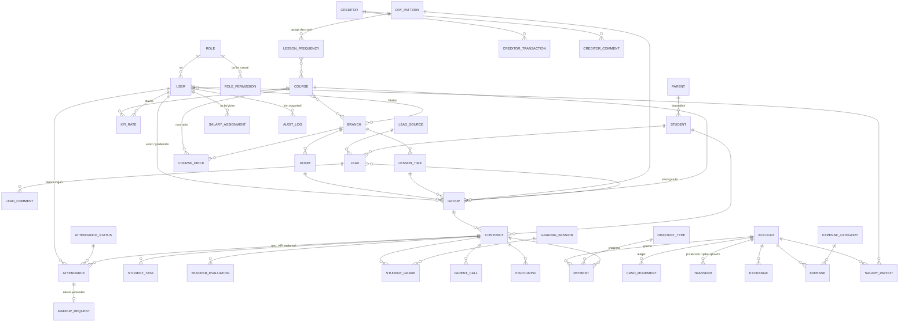

# Codial ERP — arxitektura va ishga tushirish rejasi

> Holat (2026-10-12): **arxitektura tasdiqlandi** (API + prototip interfeysi; test va asosiy server — Hetzner). M1 bajarildi (2026-10-12). 7-bo'limdagi takliflar buyurtmachi ko'rib chiqishini kutmoqda.
> Tasdiqlangach CLAUDE.md 4- va 5-bo'limlari shu hujjatga moslab yangilanadi va M1 boshlanadi.

## 1. Asosiy qaror: API + tasdiqlangan prototip interfeysi

Buyurtmachi talabi: backend **API** bilan ishlasin, front-end (ma'qullangan prototip) unga ulansin, tizim serverda real ishlasin.

| | Avvalgi reja (CLAUDE.md 4) | Yangi reja |
|---|---|---|
| Backend | Django + shablonlar | **Django 5 + Django REST Framework (API)** |
| Front-end | Django shablonlarida qaytadan yoziladi | **Prototip kodi (`prototype/`) asos qilib olinadi**, `localStorage` o'rniga API'ga ulanadi. Framework yo'q, build yo'q |
| Hisob-kitob | Servis qatlami | O'zgarmaydi: qarz, KPI, g'azna, oylik **faqat serverda**. Prototipdagi JS hisob-kitoblari (`core.js`) Python servislariga ko'chiriladi va front-end'dan olib tashlanadi |

Nega shunday:
- Ekranlar, formalar va matnlar allaqachon ma'qullangan — ularni qayta yozish vaqt yo'qotish.
- API keyin Telegram bot (M8), AI yordamchi (M9) va kerak bo'lsa mobil ilova uchun ham ishlatiladi.
- Front-end bir xil domendan (Nginx) beriladi, shuning uchun CORS kerak emas, sessiya + CSRF bilan xavfsiz kirish.

Front-end'dagi asosiy o'zgarish: hozir har sahifa `A.rows('...')` bilan brauzer xotirasidan sinxron o'qiydi. Yangi holatda har sahifada `load()` bosqichi bo'ladi: kerakli ma'lumot API'dan olinadi (filtr, sahifalash bilan), keyin hozirgi `render()` chizadi. Saqlash `A.insert/patch/softDelete` o'rniga `A.api.post/patch/delete`. Ruxsat va doira (6-bo'lim) server tomonda tekshiriladi; front-end faqat tugmalarni yashiradi.

## 2. Loyiha tuzilmasi

```
backend/
  config/                 settings (base, dev, prod), urls, wsgi
  apps/
    core/                 BaseModel (created/updated_by, soft delete, legacy_id), audit, filial doirasi, ruxsat klasslari
    accounts/             User, Role, RolePermission, RolePower, login, parol o'rnatish havolasi
    references/           Branch, Course, Room, DayPattern, LessonTime, CoursePrice, LessonFrequency,
                          DiscountType, ExpenseCategory, LeadSource, AttendanceStatus
    crm/                  Parent, Student, Lead, LeadComment
    education/            Group, Contract, Attendance, MakeupRequest, StudentTask, TeacherEvaluation,
                          GradingSession, StudentGrade, ParentCall, Discount50
    finance/              Account, CashMovement, Payment, Transfer, Exchange, Expense,
                          Creditor, CreditorTransaction, CreditorComment
    payroll/              KPIRate, SalaryAssignment, SalaryPayout
    reports/              dashboard, statistika, foyda, Excel eksport
    importer/             AppSheet .xlsx import (M10)
    (keyin) notifications/  Telegram bot (M8), ai_assistant/ (M9)
  har bir app: models.py, services.py (biznes mantiq), serializers.py, views.py, urls.py, tests/
frontend/                 prototype/ dan ko'chiriladi: index.html, assets/ (API'ga ulangan)
deploy/                   docker-compose.yml, nginx.conf, .env.example, backup skripti
docs/                     architecture.md, decisions.md, deploy_*.md, user_guide/
prototype/                o'zgarmay qoladi (GitHub Pages'dagi demo)
```

## 3. ER-diagramma (asosiy bog'lanishlar)

Har bir model `BaseModel` dan: `created_at/by`, `updated_at/by`, `is_deleted`, `legacy_id`.



`CASH_MOVEMENT` — har bir to'lov, xarajat, oylik, o'tkazma, almashtirish va kreditor amali yaratadigan yagona pul jurnali (`source_type`, `source_id`). G'azna balansi shundan indeksli yig'indi bilan olinadi.

## 4. API (qisqacha)

- Manzil: `/api/v1/…`, JSON. Kirish: `POST /auth/login` (email + parol, urinishlar limiti), `POST /auth/logout`, `GET /auth/me` (xodim, rol, ruxsatlar matritsasi, filiallar), `POST /auth/password/set` (havola orqali parol o'rnatish).
- Har bir bo'lim uchun REST: `GET /leads/?status=&course=&search=&page=`, `POST /leads/`, `PATCH /leads/{id}/`, `DELETE /leads/{id}/` (soft delete). Ro'yxatlar 50 tadan sahifalanadi.
- Amallar alohida: `POST /payments/{id}/confirm-discount/`, `POST /attendance/take/` (guruh + sana + belgilar), `POST /lesson-frequencies/{id}/approve/`, `POST /makeups/{id}/approve/` va hokazo.
- Hisoblangan qiymatlar serverdan keladi: shartnoma qarzi, guruh to'lishi, g'azna qoldig'i, oylik balansi, KPI daraxti summalari.
- Har javobda ruxsat: `can_edit`, `can_delete`, `why` (muddat o'tgan bo'lsa sababi) — prototipdagi o'chiq tugma va izoh shundan chiqadi.
- Hujjat: `/api/docs/` (OpenAPI, faqat Admin uchun).

## 5. Bosqichlar (yangilangan)

| # | Bosqich | Natija (har bosqich oxirida test serverda ko'rsatiladi) |
|---|---|---|
| M1 | Asos | Django + DRF, PostgreSQL, Docker; User/Role/ruxsatlar, filial doirasi, audit; kirish va parol o'rnatish; front-end `frontend/` ga ko'chiriladi va API klienti qo'shiladi; **Sozlamalar** bo'limi to'liq API bilan; test serverga birinchi deploy |
| M2 | CRM | Talabalar, ota-onalar, lidlar (voronka, izohlar, "Shartnoma tuzish") |
| M3 | O'quv jarayoni | Guruhlar, shartnomalar, davomat ekrani, qarz va KPI servislari, kelmaganlar, qoldirilgan darslar, oydagi dars soni (cron bilan taklif) |
| M4 | Moliya | Ledger, g'aznalar, to'lovlar (tasdiqlar, chegirma limiti, PDF chek), o'tkazmalar, ayirboshlash, xarajatlar, kreditorlar |
| M5 | Oyliklar | KPI stavkalari, oylik belgilash/berish, KPI daraxti, xodim balansi |
| M6 | Qo'shimcha | Vazifalar, baholash (ikki yo'nalish), ota-onalar bilan aloqa, 50% chegirma, Excel eksport |
| M7 | Hisobotlar | Bosh sahifa, statistika, voronka, foyda, guruhlar tahlili, audit tarixi |
| M10 | Migratsiya | AppSheet `.xlsx` import, `--dry-run`, tekshiruv hisoboti |
| M11 | Ishga tushirish | Asosiy server, domen, SSL, kunlik backup, monitoring, o'tish kuni |
| keyin | M8 Telegram bot, M9 AI yordamchi | Tizim ishga tushgandan keyin |

**Real ishga tushirish uchun minimal to'plam: M1–M7 + M10 + M11.** Xodimlar hozir AppSheet'dagi hamma bo'limdan foydalanadi, shuning uchun M6–M7 siz o'tib bo'lmaydi.

Har bosqichda: pytest testlari (hisob-kitob, ruxsat, muddatlar), `seed_demo` buyrug'i, test serverga deploy, qisqa hisobot.

## 6. Serverlar

**Tasdiqlangan:** bitta Hetzner VPS'da ikkita muhit.

| | Test (M1 dan boshlab) | Asosiy (M11 dan) |
|---|---|---|
| Manzil | `test.<domen>` | `erp.<domen>` (yoki asosiy domen) |
| Baza | alohida PostgreSQL bazasi, faqat sinov ma'lumotlari | PostgreSQL 16, haqiqiy ma'lumotlar |
| Tarkib | Docker Compose: web (Gunicorn) + db (PostgreSQL); Nginx, certbot va cron — serverning o'zida (`docs/deploy_hetzner.md`) | xuddi shu |
| Server | Hetzner Cloud CX22 yoki CX32 (2–4 vCPU, 4–8 GB RAM), Ubuntu 24.04 LTS | |

Eslatma: O'zbekistonda fuqarolarning shaxsiy ma'lumotlarini mamlakat ichida saqlash talabi bor (CLAUDE.md 15). Buyurtmachi Hetzner'ni tanladi; bu talabni yurist bilan tekshirish buyurtmachi zimmasida. Kod Docker'da bo'lgani uchun keyin istalgan hostingga ko'chiriladi.

Sizdan kerak bo'ladi: server (yoki hosting akkaunti), domen, xatlar yuborish uchun pochta (SMTP), AppSheet'dan `.xlsx` eksport fayllari (M10 da).

## 7. Ochiq savollar (CLAUDE.md 18) — taklif qilingan javoblar

Javob bermasangiz, quyidagi taklif qabul qilingan deb hisoblanadi va `docs/decisions.md` ga yoziladi.

| # | Savol | Taklif |
|---|---|---|
| 1 | Shartnoma statusi | end < bugun → Nofaol; start > bugun → Rejada; aks holda Faol |
| 2 | Kreditor amali sanasi | Oxirgi 7 kun ichida, kelajak sana mumkin emas (Admin/BM cheklovsiz) |
| 3 | 50% chegirma qoidasi | **Sizdan aniq qoida kerak** (kimga, qachon, to'lovga qanday ta'sir qiladi). Hozircha prototipdagidek ro'yxat |
| 4 | "Nofaol (–)" davomatni kim qo'yadi | Faqat Admin, BM, Filial menejeri (masalan, talaba vaqtincha to'xtatganda) |
| 5 | "All" g'azna balansi | Ha, to'lov turlari bo'yicha alohida ko'rsatiladi (prototipdagidek) |
| 6 | Davomat eslatmasi | Dars boshlanganidan 30 daqiqa keyin (M8) |
| 7 | Xarajat kategoriyasi `allowed_roles` | Ha, majburiy tekshiriladi |
| 8 | Manfiy chegirma | Taqiqlanadi; eski qarz `opening_balance` bilan kiritiladi |
| 9 | Pulni qaytarish | Alohida "Qaytarish" amali (manfiy to'lov emas), Admin/BM tasdig'i bilan |
| 10 | Administrator to'lov qabul qiladimi | Yo'q (AppSheet'dagidek faqat ko'radi). Administrator+Hisobchi qabul qiladi |
| 11 | Shartnoma PDF | Hozircha qo'lda yuklanadi; shablon bo'lsa keyin avtomatik |
| 12 | Oylik noyobligi | Har filial uchun alohida (filial, xodim, yil, oy) |
| 13 | 2-telefon majburiymi | ✅ Javob berilgan: yangi lidda majburiy |
| 14 | Ota-onalar bilan aloqa, 50%, Excel kim ishlatadi | Admin, BM, Filial menejeri, Administrator, Administrator+Hisobchi; ustozlar faqat o'z guruhlari bo'yicha ota-onalar bilan aloqa |
